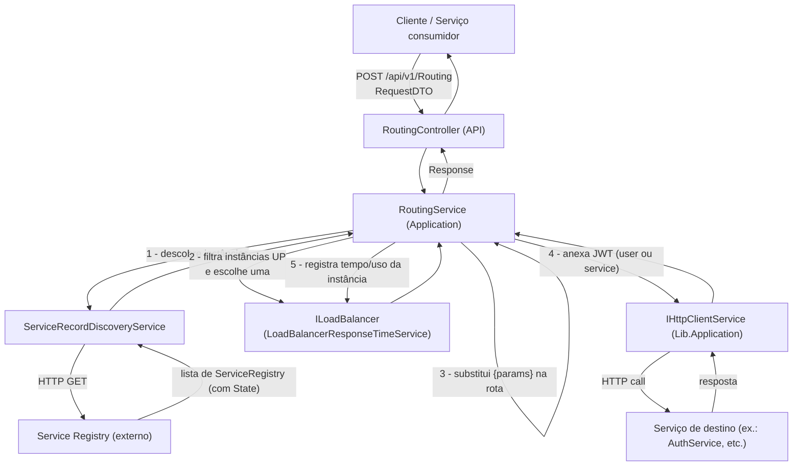
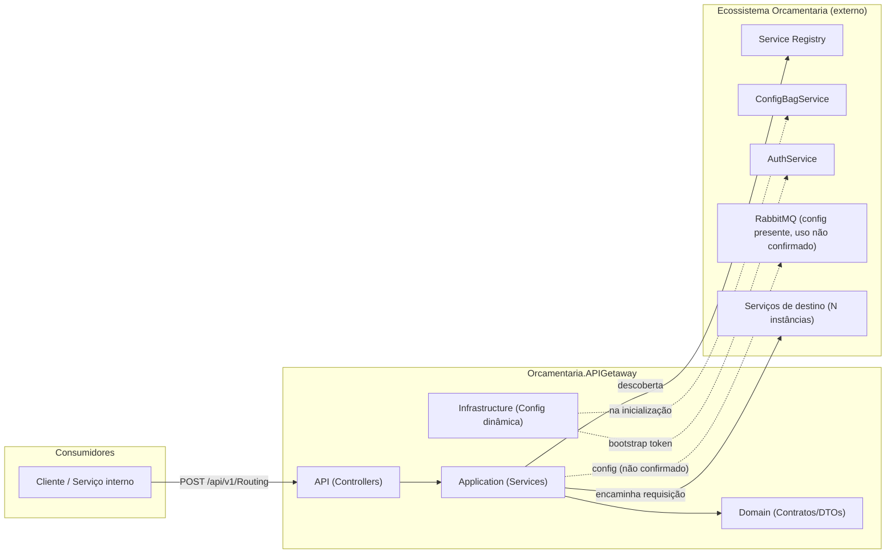
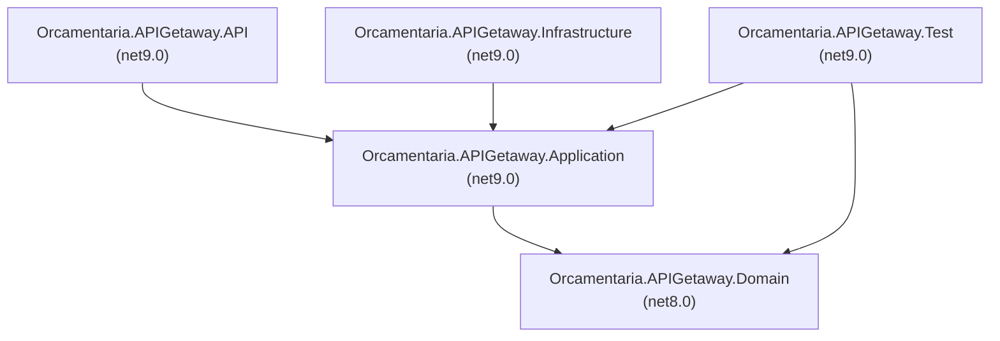

# 🌐 Orcamentaria.APIGetaway

Gateway de API do ecossistema de microsserviços **Orcamentaria**, responsável por descobrir instâncias de serviço via **Service Registry**, aplicar **balanceamento de carga** entre instâncias saudáveis e **rotear** a requisição do cliente até o serviço/endpoint de destino, propagando o token de autenticação (usuário ou serviço) adequado.

---

## 🎯 Objetivo

Em uma arquitetura de microsserviços, os clientes não devem conhecer o endereço físico de cada serviço interno. O `Orcamentaria.APIGetaway` resolve esse problema atuando como **ponto único de entrada**:

1. Recebe uma requisição genérica contendo o **nome do serviço** e o **nome do endpoint** desejados;
2. Consulta o **Service Registry** para descobrir quais instâncias desse serviço estão `UP`;
3. Escolhe uma instância usando uma estratégia de **balanceamento de carga**;
4. Substitui parâmetros de rota (`{param}`) e encaminha a chamada HTTP, anexando o **JWT** do usuário ou do serviço chamador;
5. Retorna a resposta do serviço de destino ao cliente original.

Isso desacopla os consumidores da topologia real da infraestrutura e centraliza autenticação, descoberta e roteamento.

---

## 🧰 Tecnologias

| Tecnologia | Versão (encontrada) | Finalidade |
|---|---|---|
| C# / .NET | `net9.0` (API, Application, Infrastructure, Test) e `net8.0` (Domain) ⚠️ | Linguagem e runtime da aplicação |
| ASP.NET Core Web API | SDK `Microsoft.NET.Sdk.Web` | Hospedagem da API HTTP |
| Orcamentaria.Lib.Domain | `10.0.8` (API/Application/Domain) / `9.5.9` (Infrastructure) ⚠️ | Biblioteca interna com modelos, enums, exceptions e contratos compartilhados do ecossistema |
| Orcamentaria.Lib.Application | `2.1.3` (API) / `1.7.9` (Infrastructure) ⚠️ | Biblioteca interna com serviços de aplicação compartilhados (HTTP client, Service Registry, cache) |
| Orcamentaria.Lib.Infrastructure | `5.3.2` (API) / `4.7.2` (Infrastructure) ⚠️ | Biblioteca interna que provê `ResolveCommonServices`/`ConfigureCommon` (composição comum de serviços/middlewares) |
| AutoMapper | `15.1.0` | Declarada no projeto Application, porém **nenhum uso foi encontrado** no código-fonte analisado |
| Microsoft.Extensions.Caching.Abstractions | `9.0.5` | Abstrações de cache em memória usadas no `ConfigurationBagInitializer` |
| Microsoft.Extensions.Configuration | `8.0.0` | Composição dinâmica de configuração em tempo de execução |
| Microsoft.AspNetCore.Http | `2.3.0` | `HttpContextAccessor` usado na inicialização de configuração |
| xUnit | `2.9.3` | Framework de testes unitários |
| Moq / Moq.AutoMock | não fixada / não fixada | Mock de dependências nos testes |
| FluentAssertions | não fixada | Assertions fluentes nos testes |
| Bogus | não fixada (via `Orcamentaria.Lib.Test`) | Geração de dados fake nas fixtures de teste |
| coverlet.collector | `10.0.1` | Coleta de cobertura de testes |
| Orcamentaria.Lib.Test | `1.1.4` | Base de fixtures de teste compartilhada (`BaseFixture<T>`) |

> ⚠️ Os itens marcados indicam **inconsistências reais encontradas nos arquivos `.csproj`** (mesma dependência com versões diferentes entre projetos). Ver seção [Melhorias Recomendadas](#-melhorias-recomendadas).

---

## 🏗️ Arquitetura

O projeto segue uma **arquitetura em camadas (N-Layer)**, com forte apoio em bibliotecas internas compartilhadas (`Orcamentaria.Lib.*`) que concentram infraestrutura transversal (HTTP client, cache, contexto de autenticação, composição de serviços). Não há Controllers de negócio de domínio próprio além do roteamento — o serviço é, em essência, um **API Gateway** dedicado.

- **Domain**: contratos (interfaces) e DTOs puros, sem dependência de frameworks web.
- **Application**: implementação das regras de negócio de roteamento, descoberta e balanceamento, dependendo apenas do Domain e da lib compartilhada.
- **Infrastructure**: rotina de inicialização de configuração dinâmica (`ConfigurationBagInitializer`), que busca configurações remotas via o próprio Gateway.
- **API**: camada de apresentação HTTP (Controllers), composição de DI (`Startup.cs`) e chaves públicas embarcadas para validação de token.

Padrão de dependência entre camadas: `API → Application → Domain` e `Infrastructure → Application → Domain`, sempre apontando para dentro (Domain não depende de nada do projeto).

---

## 📁 Estrutura do Projeto

```text
Orcamentaria.APIGetaway/
├── Orcamentaria.APIGetaway.API/            # Apresentação HTTP (composition root)
│   ├── Controllers/v1/RoutingController.cs #   Único endpoint público (POST /api/v1/Routing)
│   ├── Keys/                               #   Chaves públicas (.pem) embarcadas como recurso
│   ├── Program.cs / Startup.cs             #   Bootstrap e injeção de dependências
│   └── appsettings*.json                   #   Configuração da aplicação
├── Orcamentaria.APIGetaway.Application/    # Regras de negócio (services + providers)
│   ├── Services/RoutingService.cs          #   Orquestra descoberta + balanceamento + envio HTTP
│   ├── Services/ServiceRecordDiscoveryService.cs # Consulta o Service Registry
│   ├── Services/LoadBalancerOrderService.cs      # Estratégia round-robin por ordem
│   ├── Services/LoadBalancerResponseTimeService.cs # Estratégia por menor tempo de resposta (ativa)
│   └── Providers/TokenProvider.cs          #   Implementação placeholder de ITokenProvider
├── Orcamentaria.APIGetaway.Domain/         # Contratos e DTOs, sem dependências externas de framework
│   ├── DTOs/RequestDTO.cs, RequestParamDTO.cs
│   └── Services/ILoadBalancer.cs, IRoutingService.cs, IServiceRecordDiscoveryService.cs
├── Orcamentaria.APIGetaway.Infrastructure/ # Inicialização de configuração dinâmica
│   └── Initializers/ConfigurationBagInitializer.cs
├── Orcamentaria.APIGetaway.Test/           # Testes unitários (xUnit + Moq.AutoMock)
│   ├── Fixtures/ServiceRegistryFixture.cs
│   ├── Providers/TokenProviderTest.cs
│   └── Services/*.cs
└── Orcamentaria.APIGetaway.sln
```

---

## 🔄 Fluxo da Aplicação



**Passo a passo:**
1. Cliente envia `RequestDTO { ServiceName, EndpointName, Params, Content }` para `POST /api/v1/Routing`.
2. `RoutingService` chama `IServiceRecordDiscoveryService.DiscoverServiceRegistryWithEnpoint` para obter as instâncias do serviço/endpoint.
3. Filtra apenas instâncias com `State.StateId == StateEnum.UP` e usa `ILoadBalancer.GetNextService` para escolher uma.
4. Substitui os placeholders `{param}` da rota do endpoint pelos valores de `dto.Params`; se sobrar algum `{`/`}` não resolvido, lança `ValidationException`.
5. Resolve o token JWT: usa `IUserAuthContext.BearerToken`, e se nulo, usa `IServiceAuthContext.BearerToken` (fallback de serviço para serviço).
6. Envia a requisição via `IHttpClientService.SendAsync` e registra o resultado no load balancer (`RegisterUsedService`).
7. Retorna o `Response<dynamic>` recebido do serviço de destino diretamente ao cliente.

---

## 📦 Dependências principais

| Biblioteca | Descrição de uso no projeto |
|---|---|
| `Orcamentaria.Lib.Domain` | Fornece os modelos compartilhados usados aqui: `ServiceRegistry`, `Response<T>`, `HttpResponse<T>`, `StateEnum`, exceptions (`ValidationException`, `ServiceUnavailableException`, `UnexpectedException`, `ConfigurationException`), `IUserAuthContext`/`IServiceAuthContext`, `ITokenProvider`. |
| `Orcamentaria.Lib.Application` | Fornece `IHttpClientService`/`HttpClientService`, `IServiceRegistryService`/`ServiceRegistryService`, `DiscoveryServiceRegistryService`, `ApiGetawayService`, `IMemoryCacheService`/`MemoryCacheService` — a camada que efetivamente realiza chamadas HTTP e resolve o registry. |
| `Orcamentaria.Lib.Infrastructure` | Fornece `services.ResolveCommonServices(...)` e `app.ConfigureCommon(...)`, usados em `Startup.cs` para registrar/configurar toda a infraestrutura comum do ecossistema (não visível neste repositório — ver [Informações não identificadas](#-informações-não-identificadas)). |
| `AutoMapper` | Declarada como dependência do projeto Application, mas **sem uso identificado** no código-fonte. |
| `Microsoft.Extensions.Caching.Abstractions` | Cache em memória (`MemoryCache`) usado dentro de `ConfigurationBagInitializer` para instanciar o `MemoryCacheService`. |
| `xunit`, `Moq`, `Moq.AutoMock`, `FluentAssertions`, `Bogus`, `Orcamentaria.Lib.Test` | Stack de testes unitários: `AutoMocker` para criar a SUT com mocks automáticos, `BaseFixture<T>`/Bogus para gerar entidades fake, `FluentAssertions` para as asserções. |

---

## ⚙️ Configuração

A aplicação usa o modelo padrão de configuração do ASP.NET Core (`appsettings.json` + `appsettings.{Environment}.json` + variáveis de ambiente, via `Host.CreateDefaultBuilder`).

**`Orcamentaria.APIGetaway.API/appsettings.json`:**
```json
{
  "MessageBrokerConfiguration": {
    "BrokerName": "RabbitMQ",
    "Host": "localhost",
    "Port": "5672",
    "UserName": "guest",
    "Password": "guest",
    "ErrorQueue": "error",
    "ErrorCriticalQueue": "error.critical"
  },
  "ServiceRegistryConfiguration": {
    "BaseUrl": "http://localhost:3018"
  },
  "AllowedHosts": "*"
}
```

**`Orcamentaria.APIGetaway.API/appsettings.Development.json`:** contém apenas overrides de `Logging`.

> ⚠️ **Atenção:** `MessageBrokerConfiguration` está declarada no `appsettings.json`, mas **nenhuma referência direta a ela foi encontrada no código deste repositório** — presume-se que seja consumida internamente pelo `Orcamentaria.Lib.Infrastructure` através de `services.ResolveCommonServices(...)`/`app.ConfigureCommon(...)`. Não foi possível confirmar isso analisando apenas este repositório.

Adicionalmente, `Orcamentaria.APIGetaway.Infrastructure/Initializers/ConfigurationBagInitializer.cs` lê, em tempo de execução, as chaves `BaseUrlServiceRegistry` e `BaseUrlApiGetaway` via `IConfiguration.GetSection(...).Value` — **essas chaves não existem nos arquivos `appsettings*.json` versionados**, portanto devem ser fornecidas por variável de ambiente ou outro provider de configuração no ambiente de execução.

---

## 🔑 Variáveis de Ambiente

| Variável | Obrigatória | Descrição |
|---|---|---|
| `ASPNETCORE_ENVIRONMENT` | Não (default definido em `launchSettings.json` como `Development`) | Define o ambiente ASP.NET Core e qual `appsettings.{Environment}.json` é carregado. |
| `BaseUrlServiceRegistry` | Sim (lida em `ConfigurationBagInitializer.cs:51`) | URL base do Service Registry usada para autenticação bootstrap do próprio Gateway. Não encontrada em `appsettings*.json` — deve ser suprida externamente. |
| `BaseUrlApiGetaway` | Sim (lida em `ConfigurationBagInitializer.cs:96`, lança `ConfigurationException` se ausente) | URL base do próprio API Gateway, usada para buscar seu "Configuration Bag" (`ConfigBagService`). Não encontrada em `appsettings*.json` — deve ser suprida externamente. |
| `ServiceRegistryConfiguration__BaseUrl` | Não (default `http://localhost:3018` via `appsettings.json`) | URL do Service Registry usada por `ServiceRecordDiscoveryService`. |
| `MessageBrokerConfiguration__*` | Não (defaults locais em `appsettings.json`) | Host/porta/credenciais do RabbitMQ e nomes das filas de erro — uso interno não confirmado neste repositório. |

> Não foi possível determinar, a partir deste repositório, se existem outras variáveis de ambiente exigidas internamente pelas bibliotecas `Orcamentaria.Lib.*` (ex.: chaves de assinatura JWT, connection strings, etc.), pois seu código-fonte não está disponível para análise.

---

## 🗄️ Banco de Dados

Este microsserviço **não possui banco de dados próprio, ORM, migrations ou seeds** no código analisado. Não há pacotes de acesso a dados (Entity Framework, Dapper, etc.) referenciados em nenhum `.csproj`.

O único mecanismo relacionado observado é o **`ConfigurationBagInitializer`**, que busca dinamicamente, em tempo de execução, um "pacote de configuração" (`ConfigurationBagResponseDTO`) do serviço `ConfigBagService` via o próprio API Gateway, e injeta eventuais `ConnectionStrings` recebidas nesse pacote como configuração em memória (`AddInMemoryCollection`). Ou seja, connection strings — se existirem — vêm de um serviço externo em runtime, não de arquivos versionados neste repositório.

---

## ▶️ Como Executar

### Pré-requisitos
- [.NET SDK 9.0](https://dotnet.microsoft.com/download) (o projeto `Domain` está fixado em `net8.0`; recomenda-se ter também o SDK 8.0 instalado ou alinhar o `TargetFramework` — ver [Melhorias Recomendadas](#-melhorias-recomendadas))
- Acesso de rede/credenciais para o **Service Registry** e demais serviços internos do ecossistema Orcamentaria (não incluídos neste repositório)

### Passo a passo

```bash
git clone <url-do-repositorio>
cd Orcamentaria.APIGetaway

dotnet restore
dotnet build

dotnet run --project Orcamentaria.APIGetaway.API
```

A API sobe, por padrão (perfil `http` do `launchSettings.json`), em `http://localhost:5097` (perfil `https`: `https://localhost:7094` / `http://localhost:5097`), abrindo automaticamente o navegador em `/swagger`.

> 🐳 **Docker/Kubernetes:** não foram encontrados `Dockerfile`, `docker-compose.yml` ou manifestos Kubernetes neste repositório. Ver [Informações não identificadas](#-informações-não-identificadas).

---

## 🧪 Como Rodar Testes

O projeto de testes (`Orcamentaria.APIGetaway.Test`) usa **xUnit**, **Moq.AutoMock** (auto-mock de dependências via `AutoMocker.CreateInstance<T>()`), **FluentAssertions** e fixtures compartilhadas via `Orcamentaria.Lib.Test`/`Bogus`.

```bash
dotnet test
```

Para gerar relatório de cobertura com `coverlet.collector`:

```bash
dotnet test --collect:"XPlat Code Coverage"
```

**Cobertura observada (por classe testada):**

| Classe testada | Cenários cobertos |
|---|---|
| `RoutingService` | sucesso, falha na descoberta, indisponibilidade de serviço, parâmetros de rota não resolvidos, precedência de token de usuário vs. serviço, exceções inesperadas |
| `ServiceRecordDiscoveryService` | descoberta simples e com endpoint, sucesso, falha de negócio e exceção |
| `LoadBalancerOrderService` / `LoadBalancerResponseTimeService` | seleção de próxima instância e registro de uso |
| `TokenProvider` | retorno do token placeholder |

---

## 🧭 APIs

### Swagger / OpenAPI
`launchSettings.json` referencia `launchUrl: "swagger"`, indicando que o Swagger UI está habilitado. **Não há, porém, chamadas explícitas a `AddSwaggerGen`/`UseSwagger` neste repositório** — presume-se que a configuração ocorra dentro de `services.ResolveCommonServices(...)` / `app.ConfigureCommon(...)`, fornecidos pela biblioteca interna `Orcamentaria.Lib.Infrastructure`. Não foi possível confirmar os detalhes por análise apenas deste repositório.

### Endpoints identificados

| Método | Rota | Controller | Descrição |
|---|---|---|---|
| `POST` | `/api/v1/Routing` | `RoutingController.Discovery` | Recebe um `RequestDTO` (`ServiceName`, `EndpointName`, `Params`, `Content`) e encaminha a chamada ao serviço de destino, retornando `Response<dynamic>`. |

> ⚠️ `RoutingController` está declarado no namespace `Orcamentaria.AuthService.API.Controllers.v1` (arquivo `Orcamentaria.APIGetaway.API/Controllers/v1/RoutingController.cs:6`), aparentemente um resquício de cópia de outro microsserviço (`AuthService`). Isso não impede o funcionamento (o roteamento de rota HTTP usa o atributo `[Route]`, não o namespace), mas é uma inconsistência de nomenclatura — ver [Melhorias Recomendadas](#-melhorias-recomendadas).

---

## 🔗 Integrações

| Integração | Tipo | Observação |
|---|---|---|
| **Service Registry** | HTTP (externo) | Descoberta de instâncias de serviço (`GET /v1/service/{serviceName}` e `/api/v1/service/{serviceName}/{endpointName}`), via `ServiceRegistryConfiguration.BaseUrl`. |
| **ConfigBagService** | HTTP (externo, via `ApiGetawayService`) | Busca do "pacote de configuração" do próprio serviço na inicialização (`ConfigurationBagInitializer`). |
| **AuthService** | HTTP (externo, via roteamento) | Chamado durante bootstrap (`EndpointName = "AuthenticateBootstrap"`) para autenticação do próprio Gateway. |
| **RabbitMQ** | Mensageria (configurada, uso não confirmado neste repo) | Parâmetros de conexão e filas de erro (`error`, `error.critical`) presentes em `appsettings.json`, sem código de publicação visível neste repositório. |
| **Serviços de destino (downstream)** | HTTP (dinâmico) | Qualquer serviço registrado no Service Registry pode ser alvo de roteamento, conforme `ServiceName`/`EndpointName` recebidos na requisição. |

Não foram encontradas integrações com filas além de RabbitMQ, nem com serviços de storage/cache externos (o cache identificado é em memória, local ao processo).

---

## 📈 Logs

O projeto usa o provedor de logging padrão do ASP.NET Core, configurado via `appsettings.json`:

```json
"Logging": {
  "LogLevel": {
    "Default": "Information",
    "Microsoft.AspNetCore": "Warning"
  }
}
```

Não há logging estruturado (Serilog, Application Insights, OpenTelemetry) configurado neste repositório. Não há middleware de correlação/`X-Correlation-Id` visível no código analisado (pode estar em `Orcamentaria.Lib.Infrastructure`, não verificável aqui).

---

## 🚨 Tratamento de Erros

A estratégia observada é baseada em **exceptions tipadas** da biblioteca `Orcamentaria.Lib.Domain.Exceptions`:

- `DefaultException` (base) é relançada sem alteração (`catch (DefaultException) { throw; }`);
- Qualquer outra exceção não tratada é envolvida em `UnexpectedException` antes de subir;
- Casos de negócio específicos usam exceptions dedicadas: `ServiceUnavailableException` (nenhuma instância `UP`), `ValidationException` (parâmetros de rota não resolvidos), `ConfigurationException` (configuração obrigatória ausente).

`RoutingController.Discovery` possui um `try/catch (Exception ex) { throw; }` que **apenas relança a exceção original** — não adiciona tratamento (nem log) próprio; presume-se que exista um middleware global de tratamento de exceções em `app.ConfigureCommon(...)` (biblioteca interna), não visível/confirmável neste repositório.

---

## 🔐 Segurança

| Mecanismo | Status | Observação |
|---|---|---|
| JWT (Bearer) | Identificado | `RoutingService` propaga `IUserAuthContext.BearerToken` ou, na ausência, `IServiceAuthContext.BearerToken` (`Orcamentaria.Lib.Domain.Contexts`) para o serviço de destino. |
| Chaves públicas RSA/PEM | Identificado | `Orcamentaria.APIGetaway.API/Keys/public_key_service.pem` e `public_key_user.pem` estão embarcadas como `EmbeddedResource` no `.csproj`, sugerindo validação de assinatura de dois tipos de token (serviço e usuário). A lógica de validação em si não está neste repositório (provavelmente em `Orcamentaria.Lib.Infrastructure`). |
| OAuth / Identity / Keycloak / Azure AD / Auth0 | Não identificado | Nenhuma referência encontrada. |
| CORS | Não identificado neste repositório | Pode estar configurado dentro de `ConfigureCommon(...)` (lib interna). |
| Rate Limiting | Não identificado | Nenhuma referência encontrada. |
| Segredos em `appsettings.json` | ⚠️ Atenção | Credenciais padrão do RabbitMQ (`guest`/`guest`) estão versionadas em `appsettings.json` — aceitável para ambiente local, mas devem ser sobrescritas via configuração externa em outros ambientes. |

---

## 🧩 Padrões Encontrados

| Padrão | Onde aparece | Explicação |
|---|---|---|
| **Dependency Injection** | `Startup.ConfigureServices` | Todos os serviços são registrados via `IServiceCollection` (`AddScoped`) e injetados por construtor. |
| **Strategy** | `ILoadBalancer` com duas implementações (`LoadBalancerOrderService`, `LoadBalancerResponseTimeService`) | Permite trocar o algoritmo de balanceamento sem alterar `RoutingService`; atualmente `LoadBalancerResponseTimeService` é a implementação registrada no DI. |
| **Options Pattern** | `IOptions<ServiceRegistryConfiguration>`, `IOptions<ApiGetawayConfiguration>` | Configuração fortemente tipada injetada via `Microsoft.Extensions.Options`. |
| **DTO (Data Transfer Object)** | `RequestDTO`, `RequestParamDTO` | Contratos de entrada da API, independentes de entidades de domínio internas. |
| **Interface Segregation / Contratos no Domain** | `IRoutingService`, `IServiceRecordDiscoveryService`, `ILoadBalancer` | Camada `Application` implementa interfaces definidas em `Domain`, mantendo o `Domain` livre de dependências externas. |
| **Composition Root centralizado em lib compartilhada** | `services.ResolveCommonServices(...)` / `app.ConfigureCommon(...)` | Padrão específico deste ecossistema para reaproveitar configuração comum entre microsserviços (não é um padrão de GoF, mas um padrão arquitetural do projeto). |

Não foram identificados: CQRS, MediatR/Mediator, Repository/Unit of Work explícitos, Factory ou Builder customizados neste repositório.

---

## ✅ Qualidade do Código

- **Testes automatizados**: presentes (`Orcamentaria.APIGetaway.Test`, xUnit), cobrindo os quatro serviços de Application e o provider de token. Não há um número de cobertura percentual publicado nem badge de CI neste repositório.
- **Coleta de cobertura**: `coverlet.collector` está referenciado no projeto de testes, mas não há pipeline de CI configurado para gerar/publicar esse relatório automaticamente (ver abaixo).
- **Linters/Analisadores**: não foram encontrados `.editorconfig`, StyleCop, Roslyn Analyzers customizados, ESLint ou Prettier (não aplicável — projeto é 100% .NET/C#).
- **CI/CD**: a pasta `.github/workflows/` existe no repositório, porém está **vazia** — não há nenhum pipeline de build/test/deploy configurado.

---

## 💡 Melhorias Recomendadas

- **Padronizar `TargetFramework`**: o projeto `Domain` está em `net8.0` enquanto `API`, `Application`, `Infrastructure` e `Test` estão em `net9.0`. Isso funciona porque `net8.0` é compatível como dependência de um `net9.0`, mas é uma inconsistência que dificulta manutenção e pode causar confusão sobre qual versão do SDK é realmente necessária.
- **Unificar versões das bibliotecas `Orcamentaria.Lib.*`**: o projeto `Infrastructure` referencia versões visivelmente mais antigas (`Lib.Application 1.7.9`, `Lib.Domain 9.5.9`, `Lib.Infrastructure 4.7.2`) do que `API`/`Application`/`Domain` (`2.1.3`/`10.0.8`/`5.3.2`). Isso pode causar comportamento divergente em runtime dependendo de qual assembly é carregado, e dificulta rastrear qual versão está de fato em produção. Recomenda-se centralizar as versões (ex.: `Directory.Packages.props`/Central Package Management).
- **Corrigir namespace do `RoutingController`**: está declarado como `Orcamentaria.AuthService.API.Controllers.v1` em vez de algo como `Orcamentaria.APIGetaway.API.Controllers.v1` — aparente resquício de cópia de outro serviço, que pode confundir devs e ferramentas de análise estática.
- **Remover ou justificar a dependência do AutoMapper**: está declarada em `Orcamentaria.APIGetaway.Application.csproj`, mas nenhum `Profile`/`IMapper` foi encontrado em uso — dependência morta aumenta a superfície de build sem benefício aparente.
- **Tratar exceções no Controller**: `RoutingController.Discovery` tem um `catch (Exception ex) { throw; }` que não faz nada além de relançar — se não há valor de log local, o bloco `try/catch` pode ser removido; se o objetivo é logar/instrumentar, isso deveria ser feito explicitamente.
- **Documentar/ configurar CI/CD**: a pasta `.github/workflows/` existe mas está vazia — recomenda-se adicionar um pipeline mínimo de `dotnet restore/build/test` a cada PR.
- **Adicionar Health Checks**: não há endpoint de health check (`/health`) identificado neste repositório, importante para um componente crítico como um Gateway.
- **Adicionar Docker**: não há `Dockerfile`/`docker-compose.yml`; para um gateway que depende de outros serviços em runtime, containerizar facilitaria testes de integração locais.
- **Logging estruturado e correlação**: o `appsettings.json` atual só define níveis de log padrão; para um gateway (ponto único de entrada), logging estruturado com `X-Correlation-Id` propagado end-to-end traria bastante valor de observabilidade — mencionado no README anterior do projeto, mas sem implementação visível neste repositório.
- **Documentar variáveis de ambiente obrigatórias**: `BaseUrlServiceRegistry` e `BaseUrlApiGetaway` são exigidas em runtime (`ConfigurationBagInitializer`) mas não aparecem em nenhum `appsettings*.json` de exemplo — um `appsettings.Example.json` ou seção de documentação evitaria falhas de configuração em novos ambientes.

---

## 📊 Diagrama de Arquitetura



---

## 🧱 Dependências entre Módulos (projetos da solução)



> Todos os cinco projetos fazem parte de um **único microsserviço** (não há divisão em múltiplos microsserviços dentro deste repositório) — o diagrama acima representa as dependências de projeto dentro da solução `Orcamentaria.APIGetaway.sln`.

---

## ❓ Informações não identificadas

Os itens a seguir **não puderam ser confirmados** analisando exclusivamente este repositório, por dependerem do código-fonte (não disponível) das bibliotecas internas `Orcamentaria.Lib.*` ou por simplesmente não existirem nos arquivos versionados:

- **Docker**: nenhum `Dockerfile` ou `docker-compose.yml` encontrado.
- **Kubernetes**: nenhum manifesto (`*.yaml`) encontrado.
- **CI/CD**: pasta `.github/workflows/` existe, mas está vazia — nenhum pipeline configurado.
- **Swagger/OpenAPI**: o `launchSettings.json` sugere que está habilitado (`launchUrl: "swagger"`), mas a configuração real (título, versão, autenticação no Swagger) está fora deste repositório.
- **Autenticação/Autorização detalhada (JWT)**: existem chaves públicas embarcadas e contextos de autenticação (`IUserAuthContext`/`IServiceAuthContext`), mas a validação de assinatura/middleware de autenticação está implementada em `Orcamentaria.Lib.Infrastructure`, cujo código-fonte não está neste repositório.
- **Uso efetivo do RabbitMQ**: `MessageBrokerConfiguration` está definida em `appsettings.json`, mas nenhuma publicação/consumo de mensagens foi localizado no código deste repositório.
- **CORS e Rate Limiting**: sem referência neste repositório; podem estar implementados na lib compartilhada.
- **Banco de dados definitivo**: não há um banco de dados próprio; connection strings, se usadas, vêm dinamicamente do `ConfigBagService` em runtime.
- **Origem/valores reais de `BaseUrlServiceRegistry` e `BaseUrlApiGetaway`**: são lidos via `IConfiguration`, mas não constam em nenhum arquivo `appsettings*.json` versionado — presume-se injeção via variável de ambiente no ambiente de destino.
- **Percentual de cobertura de testes**: `coverlet.collector` está referenciado, mas nenhum relatório de cobertura foi encontrado versionado ou publicado por CI.

---

## 📝 Resumo Executivo

O **Orcamentaria.APIGetaway** é um **API Gateway em .NET (ASP.NET Core Web API)** para o ecossistema de microsserviços Orcamentaria. Ele expõe um único endpoint (`POST /api/v1/Routing`) que recebe o nome de um serviço/endpoint lógico, consulta um **Service Registry** externo para descobrir instâncias saudáveis, aplica uma estratégia de **balanceamento de carga por tempo de resposta**, propaga o **JWT** apropriado (usuário ou serviço) e encaminha a chamada HTTP ao serviço de destino, retornando a resposta ao chamador original.

**Estrutura:** solução em 5 projetos .NET seguindo uma arquitetura em camadas (`Domain → Application → Infrastructure/API`), fortemente apoiada em um conjunto de bibliotecas internas compartilhadas (`Orcamentaria.Lib.Domain/Application/Infrastructure/Test`) que concentram infraestrutura transversal do ecossistema (HTTP client, cache, contexto de autenticação, composição de DI/middlewares).

**Principais tecnologias:** .NET 9 (com uma inconsistência: o projeto Domain está em .NET 8), ASP.NET Core Web API, xUnit + Moq.AutoMock + FluentAssertions + Bogus para testes.

**Pontos fortes:**
- Separação clara de responsabilidades entre Domain, Application, Infrastructure e API;
- Estratégia de balanceamento de carga desacoplada via interface (`ILoadBalancer`), fácil de trocar/testar;
- Boa cobertura de testes unitários nos serviços de Application, usando mocks automáticos e fixtures reutilizáveis;
- Tratamento de exceções consistente com hierarquia de exceptions tipada da lib compartilhada.

**Pontos de atenção:**
- Inconsistências de versão entre projetos (`TargetFramework` e pacotes `Orcamentaria.Lib.*`) que merecem padronização;
- Ausência de Docker, Kubernetes e pipelines de CI/CD configurados neste repositório;
- Dependência forte e pouco documentada (a partir deste repositório) de bibliotecas internas fechadas para funcionalidades críticas como autenticação, Swagger e mensageria;
- Namespace incorreto em `RoutingController` (herdado de outro serviço) e dependência não utilizada (`AutoMapper`) que valem revisão.
