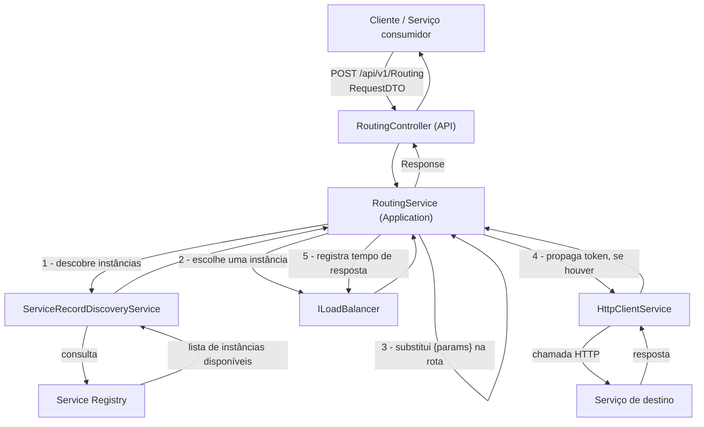
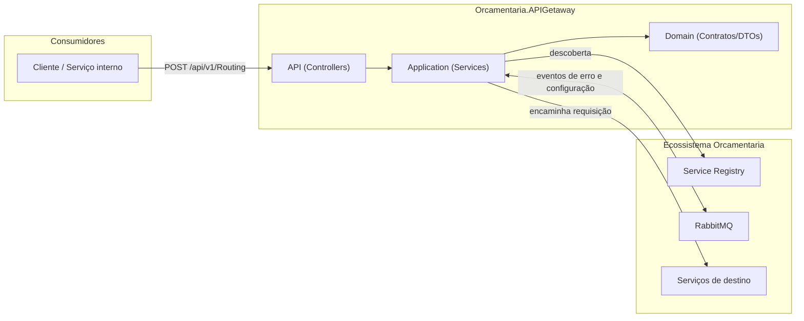
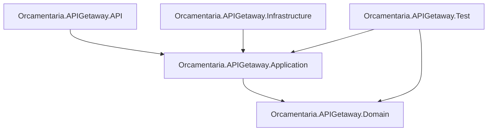

# 🌐 Orcamentaria.APIGetaway

Gateway de API do ecossistema de microsserviços **Orcamentaria**, responsável por descobrir instâncias de serviço via **Service Registry**, aplicar **balanceamento de carga** entre instâncias saudáveis e **rotear** a requisição do cliente até o serviço/endpoint de destino, propagando o token de autenticação (usuário ou serviço) quando presente.

---

## 🎯 Objetivo

Em uma arquitetura de microsserviços, os clientes não precisam conhecer o endereço físico de cada serviço interno. O `Orcamentaria.APIGetaway` resolve isso atuando como **ponto único de entrada**:

1. Recebe uma requisição genérica contendo o **nome do serviço** e o **nome do endpoint** desejados;
2. Consulta o **Service Registry** para descobrir quais instâncias desse serviço estão disponíveis;
3. Escolhe uma instância usando uma estratégia de **balanceamento de carga**;
4. Substitui os parâmetros de rota (`{param}`) e encaminha a chamada HTTP, propagando o token de autenticação do usuário ou do serviço chamador quando presente;
5. Retorna a resposta do serviço de destino ao cliente original.

Isso desacopla os consumidores da topologia real da infraestrutura e centraliza a descoberta e o roteamento entre serviços.

---

## 🧰 Tecnologias

| Tecnologia | Versão | Finalidade |
|---|---|---|
| C# / .NET | 9 | Linguagem e runtime da aplicação |
| ASP.NET Core Web API | `Microsoft.NET.Sdk.Web` | Hospedagem HTTP |
| `Orcamentaria.Lib.Domain` | 10.0.8 | Modelos, enums, exceptions e contratos compartilhados do ecossistema |
| `Orcamentaria.Lib.Application` | 2.1.3 | Implementações compartilhadas de HTTP client, Service Registry e cache |
| `Orcamentaria.Lib.Infrastructure` | 5.3.2 | Composição de serviços e middlewares comuns a todos os serviços do ecossistema |
| xUnit / Moq / Moq.AutoMock / FluentAssertions / Bogus | — | Stack de testes unitários (`Orcamentaria.APIGetaway.Test`) |
| coverlet.collector | 10.0.1 | Coleta de cobertura de testes |

---

## 🏗️ Arquitetura

O projeto segue uma **arquitetura em camadas**, apoiada na biblioteca interna compartilhada `Orcamentaria.Lib`, que concentra a infraestrutura transversal do ecossistema (autenticação, Swagger, CORS, mensageria, HTTP client, cache). O Gateway não implementa regras de domínio de negócio além do roteamento — é, essencialmente, um proxy inteligente com descoberta de serviço e balanceamento de carga.

- **Domain**: contratos (`IRoutingService`, `IServiceRecordDiscoveryService`, `ILoadBalancer`) e DTOs, sem dependência de frameworks web.
- **Application**: implementação das regras de roteamento, descoberta e balanceamento.
- **Infrastructure**: rotinas de inicialização de configuração auxiliares.
- **API**: Controllers, composição de injeção de dependência (`Startup.cs`) e chaves públicas para validação de token.

Fluxo de dependência entre camadas: `API → Application → Domain`, sempre apontando para dentro.

---

## 📁 Estrutura do Projeto

```text
Orcamentaria.APIGetaway/
├── Orcamentaria.APIGetaway.API/            # Apresentação HTTP (composition root)
│   ├── Controllers/v1/RoutingController.cs #   Endpoint de roteamento (POST /api/v1/Routing)
│   ├── Keys/                               #   Chaves públicas para validação de token
│   ├── Program.cs / Startup.cs             #   Bootstrap e injeção de dependências
│   └── appsettings*.json                   #   Configuração da aplicação
├── Orcamentaria.APIGetaway.Application/    # Regras de negócio (services + providers)
│   ├── Services/RoutingService.cs          #   Orquestra descoberta + balanceamento + envio HTTP
│   ├── Services/ServiceRecordDiscoveryService.cs # Consulta o Service Registry
│   ├── Services/LoadBalancerOrderService.cs      # Estratégia por ordem de registro
│   ├── Services/LoadBalancerResponseTimeService.cs # Estratégia por menor tempo de resposta
│   └── Providers/TokenProvider.cs          #   Implementação de ITokenProvider usada pelo Gateway
├── Orcamentaria.APIGetaway.Domain/         # Contratos e DTOs
│   ├── DTOs/RequestDTO.cs, RequestParamDTO.cs
│   └── Services/ILoadBalancer.cs, IRoutingService.cs, IServiceRecordDiscoveryService.cs
├── Orcamentaria.APIGetaway.Infrastructure/ # Inicialização de configuração
│   └── Initializers/ConfigurationBagInitializer.cs
├── Orcamentaria.APIGetaway.Test/           # Testes unitários (xUnit + Moq.AutoMock)
│   ├── Fixtures/ServiceRegistryFixture.cs
│   ├── Providers/TokenProviderTest.cs
│   └── Services/*.cs
└── Orcamentaria.APIGetaway.sln
```

---

## 🔄 Fluxo da Aplicação



**Passo a passo:**
1. O cliente envia `RequestDTO { ServiceName, EndpointName, Params, Content }` para `POST /api/v1/Routing`.
2. `RoutingService` consulta `IServiceRecordDiscoveryService` para obter as instâncias registradas do serviço/endpoint solicitado.
3. Filtra as instâncias saudáveis e usa `ILoadBalancer.GetNextService` para escolher uma — a estratégia ativa por padrão seleciona a instância com menor tempo de resposta.
4. Substitui os placeholders `{param}` da rota do endpoint pelos valores recebidos em `dto.Params`.
5. Propaga o token de autenticação do contexto da requisição (usuário, ou serviço, quando presente) para a chamada downstream.
6. Envia a requisição via `HttpClientService` e registra o tempo de resposta para as próximas decisões de balanceamento.
7. Retorna a resposta recebida do serviço de destino diretamente ao cliente.

---

## 📦 Dependências principais

| Biblioteca | Uso no projeto |
|---|---|
| `Orcamentaria.Lib.Domain` | Modelos compartilhados: `ServiceRegistry`, `Response<T>`, `HttpResponse<T>`, `StateEnum`, exceptions de domínio, contextos de autenticação. |
| `Orcamentaria.Lib.Application` | `HttpClientService`, `ServiceRegistryService`, `ApiGetawayService`, `MemoryCacheService` — realizam as chamadas HTTP e a resolução do registry. |
| `Orcamentaria.Lib.Infrastructure` | `ResolveCommonServices`/`ConfigureCommon`, usados em `Startup.cs` para configurar a infraestrutura comum do ecossistema (autenticação, Swagger, CORS, mensageria). |

---

## ⚙️ Configuração

A aplicação usa o modelo padrão de configuração do ASP.NET Core (`appsettings.json` + `appsettings.{Environment}.json` + variáveis de ambiente).

**`Orcamentaria.APIGetaway.API/appsettings.json`:**
```json
{
  "MessageBrokerConfiguration": {
    "BrokerName": "RabbitMQ",
    "Host": "localhost",
    "Port": "5672",
    "UserName": "guest",
    "Password": "guest",
    "ErrorQueue": "error",
    "ErrorCriticalQueue": "error.critical"
  },
  "ServiceRegistryConfiguration": {
    "BaseUrl": "http://localhost:3018"
  },
  "AllowedHosts": "*"
}
```

**`Orcamentaria.APIGetaway.API/appsettings.Development.json`:** contém overrides de `Logging` para o ambiente de desenvolvimento.

- **`ServiceRegistryConfiguration.BaseUrl`**: endereço do Service Registry usado nas chamadas de descoberta.
- **`MessageBrokerConfiguration`**: parâmetros de conexão RabbitMQ. O broker é usado pela infraestrutura compartilhada para publicar eventos de erro e para receber atualizações de configuração em tempo real, permitindo ajustar configurações do serviço sem reiniciar o processo.

---

## 🔑 Variáveis de Ambiente

| Variável | Descrição |
|---|---|
| `ASPNETCORE_ENVIRONMENT` | Define o ambiente ASP.NET Core (default `Development` via `launchSettings.json`). |
| `ServiceRegistryConfiguration__BaseUrl` | URL do Service Registry usada pela descoberta de serviços (default `http://localhost:3018`). |
| `MessageBrokerConfiguration__Host` / `__Port` / `__UserName` / `__Password` | Conexão com o RabbitMQ (defaults locais `guest`/`guest`/`localhost:5672`). |
| `MessageBrokerConfiguration__ErrorQueue` / `__ErrorCriticalQueue` | Nomes das filas de erro. |

---

## ▶️ Como Executar

### Pré-requisitos
- [.NET SDK 9.0](https://dotnet.microsoft.com/download)
- RabbitMQ acessível (local ou remoto)
- Service Registry em execução e acessível em `ServiceRegistryConfiguration:BaseUrl`
- Os serviços de destino a serem roteados devem estar registrados no Service Registry

### Passo a passo

```bash
git clone <url-do-repositorio>
cd Orcamentaria.APIGetaway

dotnet restore
dotnet build

dotnet run --project Orcamentaria.APIGetaway.API
```

A API sobe, por padrão, em `http://localhost:5097` (perfil HTTPS: `https://localhost:7094`), abrindo automaticamente o navegador em `/swagger`.

---

## 🧪 Como Rodar Testes

O projeto de testes (`Orcamentaria.APIGetaway.Test`) usa **xUnit**, **Moq.AutoMock** e **FluentAssertions**.

```bash
dotnet test
```

Para gerar relatório de cobertura:

```bash
dotnet test --collect:"XPlat Code Coverage"
```

**Cobertura por classe testada:**

| Classe testada | Cenários cobertos |
|---|---|
| `RoutingService` | sucesso, falha na descoberta, indisponibilidade de serviço, parâmetros de rota não resolvidos, precedência de token de usuário vs. serviço |
| `ServiceRecordDiscoveryService` | descoberta simples e com endpoint |
| `LoadBalancerOrderService` / `LoadBalancerResponseTimeService` | seleção de próxima instância e registro de uso |
| `TokenProvider` | geração de token |

---

## 🧭 APIs

### Swagger / OpenAPI
O Swagger está habilitado em ambiente de desenvolvimento, acessível em `/swagger`.

### Endpoints

| Método | Rota | Descrição |
|---|---|---|
| `POST` | `/api/v1/Routing` | Recebe um `RequestDTO` (`ServiceName`, `EndpointName`, `Params`, `Content`) e encaminha a chamada ao serviço de destino correspondente, retornando a resposta recebida. |

---

## 🔗 Integrações

| Integração | Descrição |
|---|---|
| **Service Registry** | Descoberta de instâncias e endpoints dos serviços do ecossistema. |
| **RabbitMQ** | Publicação de eventos de erro e recebimento de atualizações de configuração em tempo real. |
| **Serviços de destino** | Qualquer serviço registrado no Service Registry pode ser alvo de roteamento, conforme `ServiceName`/`EndpointName` recebidos na requisição. |

---

## 📈 Logs

Logging via `Microsoft.Extensions.Logging`, configurado em `appsettings.json`:

```json
"Logging": {
  "LogLevel": {
    "Default": "Information",
    "Microsoft.AspNetCore": "Warning"
  }
}
```

Requisições são correlacionadas entre o Gateway e os serviços downstream por meio de headers de rastreio (`RequestId`/`RequestOrderId`), propagados automaticamente em cada chamada.

---

## 🚨 Tratamento de Erros

Exceptions de negócio (indisponibilidade de serviço, parâmetros inválidos, falhas de configuração) são tratadas por um middleware central que formata a resposta de erro em JSON, com o código de status apropriado, e publica um evento no RabbitMQ para acompanhamento.

---

## 🔐 Segurança

O Gateway participa da infraestrutura de autenticação do ecossistema baseada em **JWT (RS256)**: quando uma requisição chega com um token de usuário ou de serviço, ele é validado e propagado para a chamada downstream. A validação de assinatura usa chaves públicas RSA embarcadas no serviço.

O endpoint de roteamento (`POST /api/v1/Routing`) é público — a autorização de acesso aos recursos é responsabilidade de cada serviço de destino.

---

## 🧩 Padrões Encontrados

| Padrão | Onde aparece |
|---|---|
| **Dependency Injection** | Serviços registrados via `IServiceCollection` e injetados por construtor. |
| **Strategy** | `ILoadBalancer` permite alternar a estratégia de balanceamento de carga sem alterar `RoutingService`. |
| **Options Pattern** | Configuração fortemente tipada via `IOptions<T>`. |
| **DTO** | `RequestDTO`/`RequestParamDTO` como contratos de entrada da API. |
| **Interface Segregation** | Contratos definidos em Domain, implementados em Application. |

---

## 📊 Diagrama de Arquitetura



---

## 🧱 Dependências entre Módulos



---

## 📝 Resumo Executivo

O **Orcamentaria.APIGetaway** é o API Gateway do ecossistema de microsserviços Orcamentaria, construído em .NET com ASP.NET Core Web API. Expõe um único endpoint de roteamento (`POST /api/v1/Routing`) que recebe o nome de um serviço/endpoint lógico, consulta o Service Registry para descobrir instâncias saudáveis, aplica balanceamento de carga por tempo de resposta, propaga o token de autenticação do chamador quando presente e encaminha a chamada ao serviço de destino.

A solução é organizada em camadas (`API → Application → Domain`), apoiada na biblioteca compartilhada `Orcamentaria.Lib`, que fornece autenticação JWT, Swagger, CORS e integração com RabbitMQ para eventos de erro e configuração em tempo real. O projeto conta com testes unitários cobrindo os principais serviços de roteamento, descoberta e balanceamento de carga.
