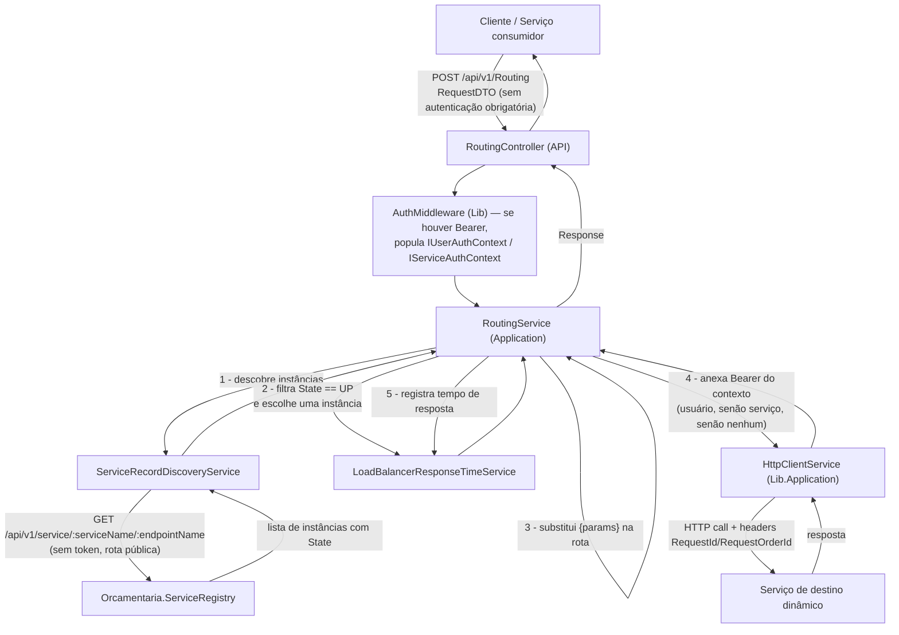
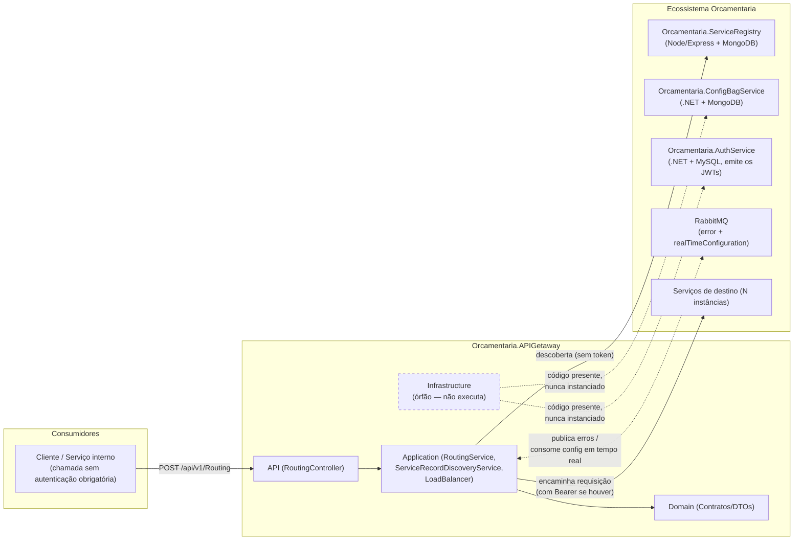
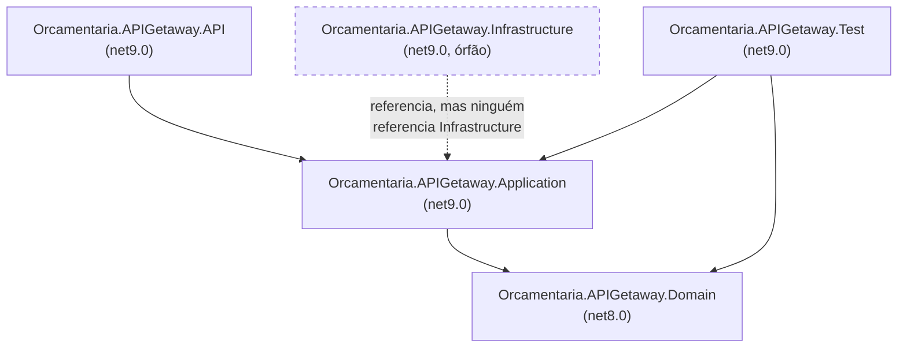

# 🌐 Orcamentaria.APIGetaway

Gateway de API do ecossistema de microsserviços **Orcamentaria**, responsável por descobrir instâncias de serviço via **Service Registry**, aplicar **balanceamento de carga** entre instâncias saudáveis e **rotear** a requisição do cliente até o serviço/endpoint de destino, propagando o token de autenticação (usuário ou serviço) adequado.

Esta versão do README foi revisada com acesso ao código-fonte da biblioteca interna compartilhada (`Orcamentaria.Lib`) e dos demais serviços "core" do ecossistema (`Orcamentaria.ServiceRegistry`, `Orcamentaria.ConfigBagService`, `Orcamentaria.AuthService`), o que permitiu confirmar (em vez de presumir) o comportamento real da infraestrutura compartilhada usada por este Gateway.

---

## 🎯 Objetivo

Em uma arquitetura de microsserviços, os clientes não devem conhecer o endereço físico de cada serviço interno. O `Orcamentaria.APIGetaway` resolve esse problema atuando como **ponto único de entrada**:

1. Recebe uma requisição genérica contendo o **nome do serviço** e o **nome do endpoint** desejados;
2. Consulta o **Service Registry** (`Orcamentaria.ServiceRegistry`) para descobrir quais instâncias desse serviço estão `UP`;
3. Escolhe uma instância usando uma estratégia de **balanceamento de carga**;
4. Substitui parâmetros de rota (`{param}`) e encaminha a chamada HTTP, anexando o **JWT** do usuário ou do serviço chamador (se presente na requisição original);
5. Retorna a resposta do serviço de destino ao cliente original.

Isso desacopla os consumidores da topologia real da infraestrutura e centraliza a descoberta e o roteamento. A autenticação em si é emitida por um serviço à parte (`Orcamentaria.AuthService`) e apenas **propagada** por este Gateway — ver [Segurança](#-segurança).

---

## 🧰 Tecnologias

| Tecnologia | Versão | Finalidade |
|---|---|---|
| C# / .NET | `net9.0` (API, Application, Infrastructure, Test) e `net8.0` (Domain) | Linguagem e runtime. O `Domain` compila contra `net8.0`, mas isso não gera erro por ser compatível como dependência de projetos `net9.0` — é uma inconsistência de padronização, não um problema funcional. |
| ASP.NET Core Web API | SDK `Microsoft.NET.Sdk.Web` | Hospedagem HTTP, MVC clássico (`Startup.cs`, não Minimal API) |
| `Orcamentaria.Lib.Domain` | `10.0.8` | Modelos, enums, exceptions e contratos compartilhados de todo o ecossistema (usada de forma consistente em API/Application/Domain) |
| `Orcamentaria.Lib.Application` | `2.1.3` | Implementações compartilhadas: `HttpClientService`, `ServiceRegistryService`, `ApiGetawayService`, `MemoryCacheService`, `RabbitMqPublishService`, hosted services |
| `Orcamentaria.Lib.Infrastructure` | `5.3.2` | Extensões `ResolveCommonServices`/`ConfigureCommon` que compõem DI + pipeline HTTP comuns a todos os serviços do ecossistema (JWT, Swagger, CORS, middlewares) |
| AutoMapper | `15.1.0` | Declarada no `.csproj` do projeto Application, mas **confirmadamente sem nenhum uso** — nem no Gateway, nem em `Orcamentaria.Lib` (onde outros serviços, como o `AuthService`, de fato usam AutoMapper). Dependência morta. |
| `Microsoft.Extensions.Caching.Abstractions` | `9.0.5` | Usada apenas pela classe `ConfigurationBagInitializer` do projeto `Infrastructure` — que, como detalhado abaixo, **não é executada** neste serviço |
| xUnit / Moq / Moq.AutoMock / FluentAssertions / Bogus | — | Stack de testes unitários (`Orcamentaria.APIGetaway.Test`) |
| coverlet.collector | `10.0.1` | Coleta de cobertura de testes |
| `Orcamentaria.Lib.Test` | `1.1.4` | Base de fixtures de teste compartilhada (`BaseFixture<T>`) |

> ⚠️ O projeto `Orcamentaria.APIGetaway.Infrastructure` referencia versões bem mais antigas da lib (`Lib.Application 1.7.9`, `Lib.Domain 9.5.9`, `Lib.Infrastructure 4.7.2`). Isso **não tem impacto em runtime**, porque — como mostrado na seção [Arquitetura](#️-arquitetura) — esse projeto não é referenciado pelo executável da API. Ainda assim, vale limpar por higiene (ver [Melhorias Recomendadas](#-melhorias-recomendadas)).

---

## 🏗️ Arquitetura

O projeto segue uma **arquitetura em camadas (N-Layer)**, apoiada fortemente na biblioteca interna compartilhada `Orcamentaria.Lib.*`, que concentra toda a infraestrutura transversal do ecossistema (autenticação JWT, Swagger, CORS, RabbitMQ, HTTP client, cache). O Gateway em si não tem regras de domínio de negócio além de roteamento — é, essencialmente, um proxy inteligente com descoberta de serviço e balanceamento de carga.

**Grafo de build real (o que efetivamente roda dentro do processo da API), confirmado pelos `<ProjectReference>` de cada `.csproj`:**

```
Orcamentaria.APIGetaway.API
   └── Orcamentaria.APIGetaway.Application
          └── Orcamentaria.APIGetaway.Domain
```

- **Domain**: contratos (`IRoutingService`, `IServiceRecordDiscoveryService`, `ILoadBalancer`) e DTOs, sem dependência de frameworks web.
- **Application**: implementação das regras de roteamento, descoberta e balanceamento; depende apenas de Domain e da lib compartilhada.
- **API**: Controllers, composição de DI (`Startup.cs`), chaves públicas RSA embarcadas para validação de JWT.
- **Infrastructure**: **não é referenciado por nenhum outro projeto da solução** (nem por API, nem por Application, nem por Domain — confirmado via busca de `<ProjectReference>` em todos os `.csproj`). Contém a classe `ConfigurationBagInitializer`, que também não é instanciada em nenhum lugar do código (nem em `Program.cs`, nem em `Startup.cs`). Na prática, **esse projeto inteiro está órfão**: faz parte da solução `.sln` (então `dotnet build` da solução o compila), mas seu código nunca é carregado ou executado pela API em runtime. Ver [Melhorias Recomendadas](#-melhorias-recomendadas).
- **Test**: referencia Application e Domain diretamente (não passa por Infrastructure).

---

## 📁 Estrutura do Projeto

```text
Orcamentaria.APIGetaway/
├── Orcamentaria.APIGetaway.API/            # Apresentação HTTP (composition root)
│   ├── Controllers/v1/RoutingController.cs #   Único endpoint público (POST /api/v1/Routing), sem [Authorize]
│   ├── Keys/                               #   public_key_service.pem / public_key_user.pem (validação JWT)
│   ├── Program.cs / Startup.cs             #   Bootstrap e injeção de dependências
│   └── appsettings*.json                   #   Configuração da aplicação
├── Orcamentaria.APIGetaway.Application/    # Regras de negócio (services + providers)
│   ├── Services/RoutingService.cs          #   Orquestra descoberta + balanceamento + envio HTTP
│   ├── Services/ServiceRecordDiscoveryService.cs # Consulta o Service Registry
│   ├── Services/LoadBalancerOrderService.cs      # Estratégia round-robin por ordem (não registrada no DI)
│   ├── Services/LoadBalancerResponseTimeService.cs # Estratégia por menor tempo de resposta (registrada e ativa)
│   └── Providers/TokenProvider.cs          #   Stub de ITokenProvider — nunca chamado em runtime (ver Segurança)
├── Orcamentaria.APIGetaway.Domain/         # Contratos e DTOs, sem dependências externas de framework
│   ├── DTOs/RequestDTO.cs, RequestParamDTO.cs
│   └── Services/ILoadBalancer.cs, IRoutingService.cs, IServiceRecordDiscoveryService.cs
├── Orcamentaria.APIGetaway.Infrastructure/ # ⚠️ Órfão — não referenciado por nenhum outro projeto, código nunca executa
│   └── Initializers/ConfigurationBagInitializer.cs
├── Orcamentaria.APIGetaway.Test/           # Testes unitários (xUnit + Moq.AutoMock)
│   ├── Fixtures/ServiceRegistryFixture.cs
│   ├── Providers/TokenProviderTest.cs
│   └── Services/*.cs
└── Orcamentaria.APIGetaway.sln
```

---

## 🔄 Fluxo da Aplicação



**Passo a passo (confirmado em código):**
1. Cliente envia `RequestDTO { ServiceName, EndpointName, Params, Content }` para `POST /api/v1/Routing`. **Não há `[Authorize]` neste endpoint** — qualquer chamador pode acioná-lo sem token.
2. Se a requisição trouxer um `Authorization: Bearer <jwt>`, o `AuthMiddleware` (da lib compartilhada) já populou `IUserAuthContext` ou `IServiceAuthContext` antes do Controller ser executado, com base na claim `token_use` do token.
3. `RoutingService` chama `IServiceRecordDiscoveryService.DiscoverServiceRegistryWithEnpoint`, que faz `GET {ServiceRegistryConfiguration.BaseUrl}/api/v1/service/{serviceName}/{endpointName}` — rota **pública** no `Orcamentaria.ServiceRegistry` (não exige token).
4. Filtra instâncias com `State.StateId == StateEnum.UP` e usa `ILoadBalancer.GetNextService` (implementação ativa: `LoadBalancerResponseTimeService`, que escolhe a instância com menor tempo de resposta registrado em cache).
5. Substitui os placeholders `{param}` da rota do endpoint pelos valores de `dto.Params`; se sobrar algum `{`/`}` não resolvido, lança `ValidationException`.
6. Resolve o token a propagar: `IUserAuthContext.BearerToken`, e se nulo, `IServiceAuthContext.BearerToken` — se nenhum dos dois estiver preenchido (requisição sem token), a chamada downstream segue **sem** header `Authorization`.
7. Envia a requisição via `HttpClientService.SendAsync` (que também propaga os headers `RequestId`/`RequestOrderId` para rastreio) e registra o tempo de resposta no load balancer.
8. Retorna o `Response<dynamic>` recebido do serviço de destino diretamente ao cliente.

---

## ⚙️ Configuração

A aplicação usa o modelo padrão de configuração do ASP.NET Core (`appsettings.json` + `appsettings.{Environment}.json` + variáveis de ambiente, via `Host.CreateDefaultBuilder`).

**`Orcamentaria.APIGetaway.API/appsettings.json`:**
```json
{
  "MessageBrokerConfiguration": {
    "BrokerName": "RabbitMQ",
    "Host": "localhost",
    "Port": "5672",
    "UserName": "guest",
    "Password": "guest",
    "ErrorQueue": "error",
    "ErrorCriticalQueue": "error.critical"
  },
  "ServiceRegistryConfiguration": {
    "BaseUrl": "http://localhost:3018"
  },
  "AllowedHosts": "*"
}
```

**`Orcamentaria.APIGetaway.API/appsettings.Development.json`:** contém apenas overrides de `Logging`.

### O que cada bloco realmente controla (confirmado em `Orcamentaria.Lib`)

- **`ServiceRegistryConfiguration.BaseUrl`**: usado por `ServiceRecordDiscoveryService` para montar as chamadas de descoberta ao `Orcamentaria.ServiceRegistry`.
- **`MessageBrokerConfiguration`**: consumida internamente por `Orcamentaria.Lib.Infrastructure`/`Orcamentaria.Lib.Application` (não há código local no Gateway que a leia diretamente) para configurar a conexão RabbitMQ usada por **dois mecanismos automáticos, ativados para qualquer serviço que chame `ResolveCommonServices` — inclusive este Gateway**:
  1. **Publicação de erros**: toda `DefaultException` capturada pelo `ErrorHandlingMiddleware` (ou pelo `try/catch` interno de `ResolveCommonServices`) é enviada, via `LogService`, ao exchange topic `error`, com routing key `error.<severity>` (ex.: `error.critical`), usando as filas `ErrorQueue`/`ErrorCriticalQueue`.
  2. **Consumo de configuração em tempo real**: `RealTimeConfigurationHostedService` (`BackgroundService` registrado incondicionalmente por `ResolveCommonServices`) declara um exchange topic `realTimeConfiguration` vinculado a uma fila `realTimeConfiguration.Orcamentaria.APIGetaway` e fica consumindo mensagens; cada mensagem recebida atualiza o `IConfiguration` em memória e chama `configuration.Reload()`. Esse exchange é exatamente o que o `Orcamentaria.ConfigBagService` publica quando alguém chama seu endpoint `POST /api/v1/ConfigurationBag/RealTimeConfigurations` — ou seja, **é possível empurrar configuração nova para este Gateway em tempo real, sem reiniciar o processo**, publicando naquele endpoint.
  
  Consequência prática: **este Gateway precisa de um broker RabbitMQ acessível já na inicialização**, pois `RealTimeConfigurationHostedService` inicia junto com o host.

### `ConfigurationBagInitializer` (Infrastructure) — confirmadamente não é executado

`Orcamentaria.APIGetaway.Infrastructure/Initializers/ConfigurationBagInitializer.cs` lê as chaves `BaseUrlServiceRegistry` e `BaseUrlApiGetaway` e faria uma chamada de bootstrap ao `AuthService` seguida de uma busca de "Configuration Bag" no `ConfigBagService`. Comparando com o restante do ecossistema:

- O `Orcamentaria.ConfigBagService` **tem e executa** uma classe equivalente no seu próprio `Startup.ConfigureServices` (busca a própria configuração, self-referenciada).
- O `Orcamentaria.AuthService` **não** chama essa classe.
- Este Gateway também **não** chama — nem a sua cópia local, nem a versão equivalente disponível em `Orcamentaria.Lib.Infrastructure.Initializers.ConfigurationBagInitializer` / `EnvsConfigure.ResolveConfigs()`.

Ou seja, hoje, o Gateway **não** busca uma "Configuration Bag" remota no startup e **não** se autentica contra o `AuthService`. As chaves `BaseUrlServiceRegistry`/`BaseUrlApiGetaway` não precisam ser configuradas para o Gateway funcionar — são lidas apenas por código morto.

### `ServiceConfiguration` — seção ausente, com efeito colateral real no Swagger

A biblioteca compartilhada usa uma seção `ServiceConfiguration` (`ServiceName`, `ClientId`, `ClientSecret`) em dois pontos: (a) para proteger `/swagger/v1/swagger.json` com os headers `ClientId`/`ClientSecret` (`ApplicationBuilderConfigure.cs`), e (b) para o hosted service de auto-registro no Service Registry (`ServiceRegistryHostedService`, ativado por `AddServiceRegistryHosted`). **O Gateway nunca chama `AddServiceRegistryHosted` nem define `ServiceConfiguration` no `appsettings.json`.**

Consequência traçada diretamente no código: como `IOptions<ServiceConfiguration>` sempre resolve (mesmo sem nenhuma seção configurada, retornando um objeto com `ClientId`/`ClientSecret` nulos), e a comparação `header.Equals(null)` nunca é verdadeira para uma `string` vazia, **toda requisição a `/swagger/v1/swagger.json` retorna 401** neste Gateway — inclusive a chamada que a própria página do Swagger UI faz para carregar o JSON da spec. Na prática, abrir `/swagger` mostra a página, mas ela falha ao carregar a especificação. Ver [Melhorias Recomendadas](#-melhorias-recomendadas).

---

## 🔑 Variáveis de Ambiente

| Variável | Obrigatória | Descrição |
|---|---|---|
| `ASPNETCORE_ENVIRONMENT` | Não (default `Development` via `launchSettings.json`) | Define qual `appsettings.{Environment}.json` é carregado. |
| `ServiceRegistryConfiguration__BaseUrl` | Não (default `http://localhost:3018`) | URL do `Orcamentaria.ServiceRegistry` usada pela descoberta de serviços. |
| `MessageBrokerConfiguration__Host` / `__Port` / `__UserName` / `__Password` | Não (defaults locais `guest`/`guest`/`localhost:5672`) | Conexão RabbitMQ — **necessária de fato**, pois o hosted service de configuração em tempo real conecta ao broker na inicialização (ver seção Configuração). |
| `MessageBrokerConfiguration__ErrorQueue` / `__ErrorCriticalQueue` | Não | Nomes das filas de erro publicadas pelo `LogService` da lib compartilhada. |
| `BaseUrlServiceRegistry`, `BaseUrlApiGetaway` | **Não** — lidas apenas por `ConfigurationBagInitializer`, que é código órfão neste repositório (ver acima). Não precisam ser configuradas. | |
| `ServiceConfiguration__ServiceName` / `__ClientId` / `__ClientSecret` | Não, mas **recomendado** se quiser que `/swagger/v1/swagger.json` funcione neste Gateway (ver acima). | |

---

## 🗄️ Banco de Dados

Este microsserviço **não possui banco de dados próprio, ORM, migrations ou seeds**. Não há pacotes de acesso a dados (Entity Framework, Dapper, MongoDB.Driver etc.) referenciados em nenhum `.csproj` do Gateway, e — diferente do que uma leitura superficial do `ConfigurationBagInitializer` sugere — **o Gateway não busca connection strings dinamicamente em runtime**, porque essa rotina é código órfão (ver [Configuração](#️-configuração)).

Dados persistentes no ecossistema Orcamentaria vivem nos outros serviços: `Orcamentaria.ServiceRegistry` usa **MongoDB** (coleções `services` e `log-services`), `Orcamentaria.ConfigBagService` usa **MongoDB** (coleção `config-bags` — apesar de ter um `Dockerfile`/`compose.yaml`/scripts de MySQL versionados que não têm relação com o serviço real, um resquício de boilerplate), e `Orcamentaria.AuthService` usa **MySQL**.

---

## ▶️ Como Executar

### Pré-requisitos
- [.NET SDK 9.0](https://dotnet.microsoft.com/download)
- **RabbitMQ acessível** em `localhost:5672` (ou apontado via `MessageBrokerConfiguration`) — o processo falha/loga erro na inicialização do hosted service de configuração em tempo real sem isso.
- `Orcamentaria.ServiceRegistry` rodando e acessível em `ServiceRegistryConfiguration:BaseUrl` (default `http://localhost:3018`) para que a descoberta de serviços funcione — sem ele, toda chamada a `POST /api/v1/Routing` falha com `ServiceUnavailableException`/`UnexpectedException`.
- Os serviços de destino (o que o Gateway vai rotear) precisam estar registrados nesse Service Registry.

### Passo a passo

```bash
git clone <url-do-repositorio>
cd Orcamentaria.APIGetaway

dotnet restore
dotnet build

dotnet run --project Orcamentaria.APIGetaway.API
```

A API sobe, por padrão (perfil `http` do `launchSettings.json`), em `http://localhost:5097` (perfil `https`: `https://localhost:7094` / `http://localhost:5097`), abrindo automaticamente o navegador em `/swagger`. **Atenção**: sem a seção `ServiceConfiguration` no `appsettings.json`, a spec JSON do Swagger não carrega — comportamento já conhecido pela equipe e sem prioridade de correção no momento (ver [Configuração](#️-configuração)).

> 🐳 **Docker/Kubernetes:** não há `Dockerfile`, `docker-compose.yml` ou manifestos Kubernetes neste repositório do Gateway ainda. A containerização do ecossistema completo (Gateway + ServiceRegistry + ConfigBagService + AuthService + RabbitMQ) está em andamento, mas **ainda não foi totalmente implementada** — dos quatro repositórios "core" analisados, apenas `Orcamentaria.ConfigBagService` tem `Dockerfile`/`compose.yaml` até o momento, e esses arquivos específicos apontam para MySQL e nomes de pastas antigos, incompatíveis com o serviço real (que usa MongoDB), então não devem ser usados como estão enquanto o trabalho de containerização não avança.

---

## 🧪 Como Rodar Testes

O projeto de testes (`Orcamentaria.APIGetaway.Test`) usa **xUnit**, **Moq.AutoMock** (auto-mock de dependências via `AutoMocker.CreateInstance<T>()`), **FluentAssertions** e fixtures compartilhadas via `Orcamentaria.Lib.Test`/`Bogus`.

```bash
dotnet test
```

Para gerar relatório de cobertura com `coverlet.collector`:

```bash
dotnet test --collect:"XPlat Code Coverage"
```

**Cobertura observada (por classe testada):**

| Classe testada | Cenários cobertos |
|---|---|
| `RoutingService` | sucesso, falha na descoberta, indisponibilidade de serviço, parâmetros de rota não resolvidos, precedência de token de usuário vs. serviço, exceções inesperadas |
| `ServiceRecordDiscoveryService` | descoberta simples e com endpoint, sucesso, falha de negócio e exceção |
| `LoadBalancerOrderService` / `LoadBalancerResponseTimeService` | seleção de próxima instância e registro de uso |
| `TokenProvider` | retorno do token placeholder (o teste confirma o comportamento do stub, não gera token real) |

---

## 🧭 APIs

### Swagger / OpenAPI
Confirmado em `Orcamentaria.Lib.Infrastructure.Configures.DependencyInjectionConfigure.ResolveCommonServices`: `AddSwaggerGen` registra um `SwaggerDoc` por versão de API e um esquema de segurança `"Bearer"` (header `Authorization`). No pipeline (`ConfigureCommon`), `UseSwagger()` roda sempre, e `UseSwaggerUI()` + `UseDeveloperExceptionPage()` só em ambiente `Development`. Como descrito em [Configuração](#️-configuração), neste Gateway o acesso ao JSON da spec (`/swagger/v1/swagger.json`) está bloqueado por um gate de `ClientId`/`ClientSecret` que nunca é satisfeito, pois `ServiceConfiguration` não está configurada.

### Endpoints identificados

| Método | Rota | Controller | Autenticação | Descrição |
|---|---|---|---|---|
| `POST` | `/api/v1/Routing` | `RoutingController.Discovery` | **Nenhuma** (sem `[Authorize]`) | Recebe um `RequestDTO` (`ServiceName`, `EndpointName`, `Params`, `Content`) e encaminha a chamada ao serviço de destino, retornando `Response<dynamic>`. Se a requisição trouxer um Bearer válido, ele é propagado ao destino; caso contrário, a chamada segue sem token. |

> ⚠️ `RoutingController` está declarado no namespace `Orcamentaria.AuthService.API.Controllers.v1` (arquivo `Orcamentaria.APIGetaway.API/Controllers/v1/RoutingController.cs:6`) — resquício de cópia do projeto `AuthService`. Não afeta o roteamento HTTP (que usa o atributo `[Route]`), mas é uma inconsistência de nomenclatura.

---

## 🔗 Integrações

| Integração | Status | Observação |
|---|---|---|
| **Orcamentaria.ServiceRegistry** | ✅ Ativa | Descoberta via `GET /api/v1/service/{serviceName}/{endpointName}` (rota pública, sem token) contra `ServiceRegistryConfiguration.BaseUrl`. O método auxiliar `ServiceRecordDiscoveryService.DiscoverServiceRegistry(serviceName)` monta a rota `/v1/service/{serviceName}` **sem o prefixo `/api`** — inconsistente com a rota real do registry (`/api/v1/service/:serviceName`) e, portanto, retornaria 404 se fosse chamado; hoje esse método não é usado em nenhum lugar do Gateway, então o bug é inofensivo mas real. |
| **RabbitMQ** | ✅ Ativa (obrigatória) | Dois usos automáticos via `Orcamentaria.Lib`: publicação de exceções no exchange `error` (routing key `error.<severity>`) e consumo de configuração em tempo real no exchange `realTimeConfiguration` (fila `realTimeConfiguration.Orcamentaria.APIGetaway`). Requer broker acessível na inicialização. |
| **Serviços de destino (downstream)** | ✅ Ativa (dinâmica) | Qualquer serviço registrado no Service Registry pode ser alvo de roteamento, conforme `ServiceName`/`EndpointName` recebidos na requisição. |
| **Orcamentaria.ConfigBagService** | ❌ Não conectada hoje | Só seria acionada pelo `ConfigurationBagInitializer`, que é código órfão neste repositório (ver [Configuração](#️-configuração)). A rota real do lado do ConfigBagService é `GET /api/v1/ConfigurationBag/GetByServiceName/{serviceName}` (roles `MASTER`/`CONFIGURATION_BAG:READ`). |
| **Orcamentaria.AuthService** | ❌ Não conectada hoje | Idem — só seria acionada pelo bootstrap do `ConfigurationBagInitializer` órfão, que chamaria `POST /api/v1/Authentication/Bootstrap/Authenticate/{bootstrapSecret}`. O Gateway também não chama `AddServiceRegistryHosted`, então não se autentica nem se registra como serviço no Service Registry (diferente de `AuthService`/`ConfigBagService`, que fazem isso). |

Não há integrações com filas além de RabbitMQ, nem com serviços de storage/cache externos — o único cache é em memória, local ao processo (`IMemoryCache`, sem TTL padrão a menos que o chamador especifique um).

---

## 📈 Logs

Logging de framework (`Microsoft.Extensions.Logging`) configurado via `appsettings.json`:

```json
"Logging": {
  "LogLevel": {
    "Default": "Information",
    "Microsoft.AspNetCore": "Warning"
  }
}
```

Não há provedor de logging estruturado (Serilog, OpenTelemetry, Application Insights) — apenas o provedor de console/debug padrão do ASP.NET Core.

**Correlação de requisições**: o mecanismo real (confirmado em `Orcamentaria.Lib.Infrastructure.Middlewares.RequestMiddleware`) **não usa `X-Correlation-Id`**. Ele lê os headers `RequestId`/`RequestOrderId` da requisição recebida (gerando um novo `RequestId` via `Guid` se ausente, e incrementando `RequestOrderId` a cada hop) e os grava em `IRequestContext`. O `HttpClientService` reenvia esses mesmos dois headers em toda chamada downstream — formando a cadeia de rastreamento entre o Gateway e os serviços de destino.

**Erros** não viram apenas linha de log: toda `DefaultException` tratada pelo `ErrorHandlingMiddleware` é serializada e publicada no RabbitMQ (exchange `error`), como descrito em [Configuração](#️-configuração) — esse é o mecanismo de observabilidade de erro do ecossistema, não um logger de texto tradicional.

---

## 🚨 Tratamento de Erros

- Exceptions de negócio da lib compartilhada (`Orcamentaria.Lib.Domain.Exceptions.DefaultException` e subclasses — `ServiceUnavailableException`, `ValidationException`, `UnexpectedException`, `ConfigurationException` etc.) são propagadas normalmente pelos services do Gateway (`catch (DefaultException) { throw; }`, `catch (Exception ex) { throw new UnexpectedException(...); }`).
- `RoutingController.Discovery` tem um `try/catch (Exception ex) { throw; }` que apenas relança — não adiciona log nem tratamento próprio.
- O tratamento efetivo acontece no `ErrorHandlingMiddleware` (`Orcamentaria.Lib.Infrastructure.Middlewares`), registrado no pipeline via `ConfigureCommon`. Ele **só captura `DefaultException`** — qualquer exceção que não derive dela (ex.: um `NullReferenceException` de um bug não previsto) **não é interceptada** por esse middleware e sobe como erro 500 padrão do Kestrel (ou página de exceção do `UseDeveloperExceptionPage` em Development).
- Para as exceptions capturadas: monta um `RequestExceptionOrigin` (host, rota, método, body, query), publica no RabbitMQ via `LogService` (ver [Logs](#-logs)), e responde ao cliente com `ContentType: application/json`, `StatusCode = (int)ex.ErrorCode` e um corpo `Response<dynamic>` com a(s) mensagem(ns) de erro.

---

## 🔐 Segurança

| Mecanismo | Status | Detalhe confirmado |
|---|---|---|
| Endpoint `POST /api/v1/Routing` | **Aberto (decisão intencional, por enquanto)** | Sem `[Authorize]` no `RoutingController` — qualquer chamador pode acioná-lo sem token. Confirmado com a equipe que essa abertura é proposital neste momento do projeto, não uma lacuna a corrigir imediatamente. |
| JWT (Bearer) | Implementado na lib compartilhada, usado passivamente pelo Gateway | `ResolveCommonServices` registra **três schemes** JWT Bearer (`userJwt`, `serviceJwt`, `bootstrapJwt`), selecionados dinamicamente por um `AddPolicyScheme("smartJwt", ...)` que inspeciona a claim `aud`/`token_use` do token recebido. Emissor esperado: `orcamentaria.auth` (o `AuthService`). Como o Controller não exige `[Authorize]`, essa validação só tem efeito prático via `AuthMiddleware`, que popula `IUserAuthContext`/`IServiceAuthContext` quando um Bearer válido está presente — usado depois por `RoutingService` para repassar o token ao destino. |
| Chaves RSA (`public_key_service.pem`, `public_key_user.pem`) | Confirmado, e confirmadas **idênticas** (mesmo conteúdo, hash SHA-256 igual) às chaves públicas do `Orcamentaria.AuthService` | O `AuthService` guarda as chaves **privadas** correspondentes e assina os JWTs com RS256; este Gateway (e os demais serviços) só têm as públicas, embarcadas como `EmbeddedResource` no assembly `Orcamentaria.APIGetaway.API`, e usadas por `RsaService.GenerateRsaSecurityKey` para validar assinatura. |
| Autoregistro no Service Registry | **Não feito** | O Gateway não chama `AddServiceRegistryHosted` nem define `ServiceConfiguration` — diferente de `AuthService`/`ConfigBagService`, ele não se registra nem envia heartbeat ao Service Registry. |
| `ITokenProvider` | Stub inofensivo, confirmadamente morto | `TokenProvider.GetTokenAsync` sempre retorna `"_blanck"`, sobrescrevendo o `ServiceTokenProvider` real da lib. Na prática **nunca é chamado**: `ServiceRegistryService.SendServiceRegister<T>` só invoca `ITokenProvider` quando `endpoint.RequiredAuthorization == true`, e os dois endpoints de descoberta construídos por `ServiceRecordDiscoveryService` têm `RequiredAuthorization = false`. |
| CORS | Permissivo | Policy única (`AllowAnyOrigin().AllowAnyHeader().AllowAnyMethod()`), aplicada globalmente via `UseCors` na lib compartilhada — sem allowlist de origens. |
| Rate Limiting | Ausente | Nenhuma referência a `AddRateLimiter`/`UseRateLimiter` em todo o código de `Orcamentaria.Lib`. |
| Health Checks | Ausente | Nenhuma referência a `AddHealthChecks` em todo o código de `Orcamentaria.Lib` nem no Gateway. |
| Segredos versionados | ⚠️ Atenção | Credenciais padrão do RabbitMQ (`guest`/`guest`) estão versionadas em `appsettings.json` — aceitável só para ambiente local. |

---

## 🧩 Padrões Encontrados

| Padrão | Onde aparece | Explicação |
|---|---|---|
| **Dependency Injection** | `Startup.ConfigureServices` | Serviços registrados via `IServiceCollection` e injetados por construtor. |
| **Strategy** | `ILoadBalancer` com duas implementações | `LoadBalancerOrderService` (round-robin por ordem de registro) existe mas **não está registrada no DI**; `LoadBalancerResponseTimeService` (menor tempo de resposta em cache) é a única efetivamente ativa (`Startup.cs`: `services.AddScoped<ILoadBalancer, LoadBalancerResponseTimeService>()`). |
| **Options Pattern** | `IOptions<ServiceRegistryConfiguration>` | Configuração fortemente tipada via `Microsoft.Extensions.Options`. |
| **DTO** | `RequestDTO`, `RequestParamDTO` | Contratos de entrada da API. |
| **Interface Segregation** | `IRoutingService`, `IServiceRecordDiscoveryService`, `ILoadBalancer` | Definidos em Domain, implementados em Application. |
| **Policy Scheme dinâmico de autenticação** | `smartJwt` (lib compartilhada) | Um único ponto de entrada de autenticação decide, por inspeção do próprio token, qual dos três `JwtBearer` schemes usar para validação — padrão específico deste ecossistema para suportar múltiplos "tipos" de portador de token (usuário, serviço, bootstrap) sob a mesma pipeline. |

Não foram identificados no Gateway: CQRS, MediatR/Mediator, Repository/Unit of Work explícitos, Factory ou Builder customizados.

---

## ✅ Qualidade do Código

- **Testes automatizados**: presentes (`Orcamentaria.APIGetaway.Test`, xUnit), cobrindo os quatro serviços de Application e o provider de token.
- **Coleta de cobertura**: `coverlet.collector` referenciado, mas sem pipeline de CI para gerar/publicar o relatório.
- **Linters/Analisadores**: nenhum `.editorconfig`, StyleCop ou Roslyn Analyzer customizado encontrado.
- **CI/CD**: a pasta `.github/workflows/` existe, mas está **vazia** — sem nenhum pipeline configurado (mesmo padrão observado em `Orcamentaria.AuthService`).

---

## 💡 Melhorias Recomendadas

- **Remover ou reconectar o projeto `Infrastructure`**: hoje ele não é referenciado por ninguém e seu único conteúdo (`ConfigurationBagInitializer`) nunca executa. Se a intenção é que o Gateway busque uma "Configuration Bag" remota no startup (como o `ConfigBagService` faz consigo mesmo), é preciso chamar `EnvsConfigure.ResolveConfigs(...)` (ou o equivalente local) a partir do `Startup.ConfigureServices`; caso contrário, remover o projeto evita manter código morto e dependências desatualizadas da lib.
- **Corrigir a rota de `ServiceRecordDiscoveryService.DiscoverServiceRegistry`**: está montando `/v1/service/{serviceName}` sem o prefixo `/api`, divergente da rota real do `Orcamentaria.ServiceRegistry`. Método não usado atualmente, mas incorreto.
- **Remover `AutoMapper`**: dependência sem uso confirmado tanto no Gateway quanto na lib compartilhada.
- **Remover ou documentar o stub `ITokenProvider`**: hoje ele existe só para sobrescrever o `ServiceTokenProvider` padrão da lib, mas nunca é chamado (`RequiredAuthorization = false` nos dois endpoints de descoberta usados). Deixar isso documentado evita que outro desenvolvedor assuma que ele é necessário para autenticação de fato.
- **Corrigir namespace do `RoutingController`**: `Orcamentaria.AuthService.API.Controllers.v1` → deveria ser algo como `Orcamentaria.APIGetaway.API.Controllers.v1`.
- **Adicionar Health Checks**: nenhum endpoint `/health` — importante para um componente crítico de entrada.
- **Configurar CI/CD**: `.github/workflows/` existe mas está vazia.
- **Concluir a containerização**: o trabalho de Docker/Kubernetes para o ecossistema já começou (segundo a equipe), mas ainda não está finalizado neste repositório nem totalmente consistente nos demais (ver [Como Executar](#️-como-executar)).
- **Padronizar `TargetFramework`**: alinhar `Domain` (`net8.0`) com os demais projetos (`net9.0`).
- **Atualizar versões da lib no projeto `Infrastructure`** (ou remover o projeto, ver acima) — hoje ficam bem atrás mesmo da versão usada por API/Application/Domain.

> `ServiceConfiguration` ausente (quebrando `/swagger/v1/swagger.json`) e a ausência de `[Authorize]` no `RoutingController` **não** entram nesta lista: são comportamentos já conhecidos pela equipe e sem prioridade de correção neste momento — documentados em [Configuração](#️-configuração) e [Segurança](#-segurança) apenas para referência futura.

---

## 📊 Diagrama de Arquitetura



---

## 🧱 Dependências entre Módulos (projetos da solução)



> Todos os cinco projetos fazem parte de um **único microsserviço**. O grafo sólido (`API → Application → Domain`) é o que efetivamente compõe o executável; `Infrastructure` é alcançável apenas pelo `.sln` como um todo, não pelo binário da API.

---

## 📝 Resumo Executivo

O **Orcamentaria.APIGetaway** é um **API Gateway em .NET (ASP.NET Core Web API)** para o ecossistema de microsserviços Orcamentaria. Expõe um único endpoint público, sem autenticação obrigatória (`POST /api/v1/Routing`, decisão intencional neste momento do projeto), que recebe o nome de um serviço/endpoint lógico, consulta o `Orcamentaria.ServiceRegistry` (Node/Express + MongoDB) para descobrir instâncias saudáveis, aplica balanceamento por menor tempo de resposta, propaga o JWT do chamador (se houver) e encaminha a chamada ao serviço de destino.

**Estrutura real**: apenas 3 dos 5 projetos da solução (`API → Application → Domain`) compõem o binário que roda em produção; o projeto `Infrastructure` está órfão — presente na solução, mas nunca referenciado nem executado.

**Integrações confirmadamente ativas**: Service Registry (descoberta, sem autenticação) e RabbitMQ (publicação de erros + consumo de configuração em tempo real, este último exigindo broker disponível já no boot). **Integrações confirmadamente inativas hoje**: ConfigBagService e AuthService, cujo único ponto de contato no código (`ConfigurationBagInitializer`) é código morto.

**Segurança**: a infraestrutura de JWT (3 schemes RS256, chaves compartilhadas com o `AuthService`) está pronta e configurada pela lib compartilhada, mas o único endpoint do Gateway não a exige por decisão de projeto — o token, quando presente, é apenas repassado adiante.

**Containerização**: em andamento no ecossistema, mas ainda não finalizada — nenhum `Dockerfile`/`compose` funcional neste repositório no momento.

**Pontos fortes**: separação clara de camadas no código que de fato roda; estratégia de balanceamento desacoplada via interface; boa cobertura de testes unitários nos services de Application.

**Pontos de atenção, todos confirmados em código**: projeto `Infrastructure` órfão e código de bootstrap de configuração morto; dependência `AutoMapper` não utilizada; ausência de health checks e pipeline de CI/CD. (O endpoint aberto e o Swagger quebrado por falta de `ServiceConfiguration` são comportamentos conhecidos e aceitos pela equipe por ora, não pendências.)
